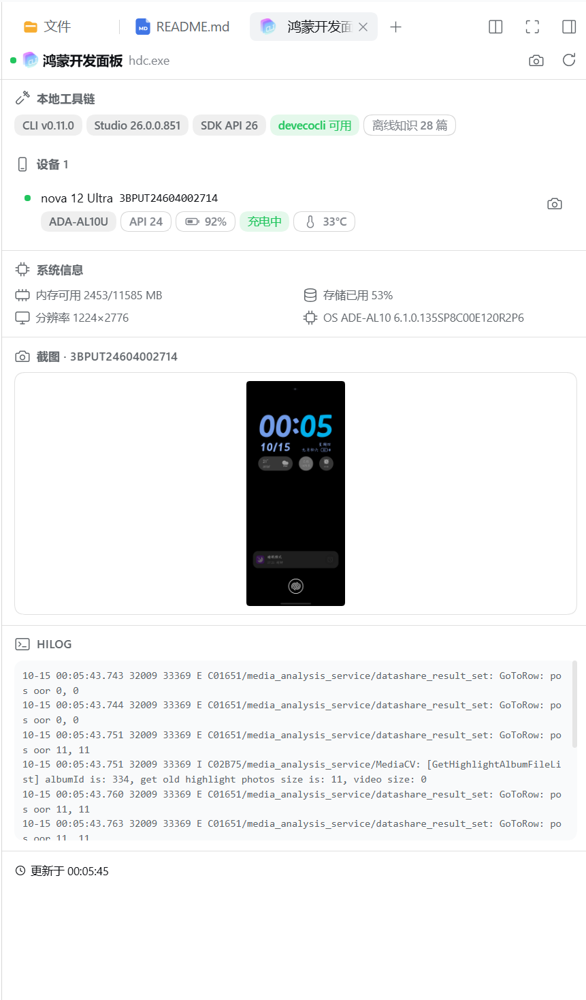

# dsh-hdc-panel

> DSH 原生鸿蒙开发助手：`hdc` 设备闭环调试（看设备 → 截图 → 看图 → 改码 → 装包 → 验证）＋ 官方优先版本化知识层（官方 KMS MCP + 离线随包 + Gitee 云端按需 + SDK 机读 + 官方文档检索）＋ 可选官方 DevEco CLI 构建/签名通道。
> A DSH-native HarmonyOS dev assistant: the hdc device loop (inspect → screenshot → view → fix → install → verify), an official-first version-classified knowledge layer (official KMS MCP + offline bundled + on-demand Gitee + SDK-accurate reads + official docs search), and an optional official DevEco CLI build/sign backend.

## 定位

[hdc_mcp](https://github.com/yushun667/hdc_mcp) 等 MCP 服务器已覆盖 hdc 能力层。本插件不重写 hdc 协议，直接复用本机 hdc 二进制（3.x），价值在 DSH 原生层：

- 会话内工具卡片与 `read_image` 原生闭环
- 按调用会话解析沙箱策略（与 `pwsh` 工具同款路线），截图写入 `<workspace>/.dsh-hdc/screenshots/`
- 结构化的失败上报（hdc 传输层退出码不可靠，插件用输出标记 + 落盘校验兜底）
- 设备面板按官方右侧栏 tab 类型集成（「开始」面板 guide 入口 + 右侧栏内嵌面板；边栏底部保留状态入口，无 tab API 时回退浮动面板）
- 会话级编译、静态检查、部署与日志工具全链（switch_cwd / build_project / arkts_check / start_app / hdc_log）

## 截图

右侧栏设备面板（「开始」面板「鸿蒙开发面板」卡片或侧栏底部「鸿蒙」状态入口打开；设备列表 / 系统区 / 工具链徽章 / hilog 尾部，官方主题随深浅色自适应）：



## 工具总览

> 约定：所有工具**失败不抛异常**，统一返回业务值 `{ ok: false, error, hint }`（error 为可读原因，hint 为修复指引）；成功返回带 `ok: true` 的结果对象。工具描述里同时给出 error 示例。这是本插件的显式约定（官方工具层允许抛 ToolFailure，本插件为面板/技能一致性选择返回值形式并在此声明）。

这份 README 是 `dsh-hdc-panel` 的项目版使用手册。它不仅列出原始工具，还说明模型在真实鸿蒙工程中应如何编排调用、如何判断回退是否真的成功，以及安装本插件后新增的 DSH 能力边界。

### 设备层（13 个工具，复用本机 hdc）

| 工具 | 说明 |
| --- | --- |
| `hdc_list_targets` | 列出已连接设备/模拟器（空列表 + 连接指引） |
| `hdc_connect` | `hdc tconn`（严格 host:port 校验） |
| `hdc_shell` | 设备 shell（param get / ps / uitest dumpLayout…） |
| `hdc_screenshot` | 截图 → 拉取 JPEG → 落盘校验（API 10+ 的 snapshot_display 仅支持 .jpeg） |
| `hdc_install` | 安装 .hap（默认 -r；输出标记级失败检测） |
| `hdc_hilog` | hilog 尾部 N 行（过滤：tag `-T`、domain `-D`、level `-L`、pid `-P`、regex `-e`） |
| `hdc_fport` | TCP 端口转发管理：add / remove / list（hdc fport，主机侧规则） |
| `hdc_file` | 主机与设备间文件传输：send / recv（hdc file；配合 hdc_shell 检查设备侧路径） |
| `hdc_target` | 目标管理：disconnect（tdisconn，省略 address 断开全部 TCP）/ reboot / mode（tmode usb/tcp） |
| `hdc_ui_dump` | 文本化 UI 快照：uitest 布局树 → 可见文本节点（纯文本模型的「文字截图」） |
| `hdc_ui_find` | 按文本/hint 找控件：返回 bounds 与中心坐标，配合 tap 免手算坐标 |
| `hdc_ui` | UI 操作：tap / doubleTap / longPress / swipe / input / key（Back/Home/Power/keyID），配合 dump 形成「观察 → 操作 → 验证」闭环 |
| `hdc_app` | 应用管理：query / start / stop / clear-data / uninstall（破坏性动作已标注） |
| `hdc_crash` | 崩溃抓取：faultlogger 目录里最近的 jscrash / cppcrash / appfreeze，可按包名过滤，并解析结构化摘要（错误名/信息/错误码/源码帧/已知错误码提示） |
| `hdc_diag` | 诊断：shell 口味 / hdc 路径 / 策略解析 / 探测日志 |
| `hdc_log` | 收集、清除或列出设备日志；支持关键词、bundle 和 PID 过滤 |

> 安装 / app / build 失败时按 11 条已知错误码附中文修复建议（9568332 签名未绑 UDID→AGC 登记设备、9568289/9568322 签名配置、1300002 空间不足…）；签名类错误附三类修复（AGC 证书配置 / 重装自签名 / 换 debug 签名）+ 直达 AGC 链接。

### 官方工具链层（7 个工具）

| 工具 | 说明 |
| --- | --- |
| `hms_setup` | 环境体检：hdc / DevEco Studio / SDK(API 版本) / devecocli / 设备五项 + 目标 API 版本三源解析（项目→设备→SDK）与不一致告警；CLT 形态额外回显 `apiVersion` 与根识别方式 |
| `hms_build` | 官方构建/签名/运行通道：status / build / run / sign / clean；devecocli 缺失时自动回退本机 hvigorw + hdc_install + hdc_app 闭环 |
| `hms_api` | 官方优先的版本化 API 知识：读本机 SDK `.d.ts`（`@since`/`@deprecated`/`@syscap` 精确到 API 版本），按目标版本分类"可用/已废弃/不可用" |
| `hms_knowledge` | **官方知识层（Tier-1 官方 KMS MCP + Tier-2 随包 + Tier-3 云端按需）**，详见下文专节 |
| `hms_docs` | 官方本地文档检索：`devecocli docs` search / read / catalog（全量文档，需 devecocli） |
| `hms_api_change` | 官方跨版本破坏性变更扫描：`devecocli check compat`（versions / diff）——回答"知识在哪一版变了" |
| `hms_lint` | 官方 lint：rules（本机 57+ 条 codelinter 规则索引）/ read-rule / check（JSON 报告经 `--output-path` 落工作区暂存、读后即删） |
| `hms_emulator` | 官方模拟器控制（devecocli emulator）：list / start / stop / create / delete + 状态注入 shake / power / rotate / volume / fold / battery / geolocation / sensor / scene |

### 会话编译层（5 个工具，移植自 deveco-code）

`switch_cwd`（切换会话工程根目录）、`build_project`（构建并验证 `.hap` 产物）、`arkts_check`（SDK ets-loader ArkTS 静态检查）、`start_app`（不重新构建地部署启动）、`hdc_log`。五个工具共享会话工程根目录、沿用官方参数命名，并在本插件层补充 hdc 设备过滤、HAP 产物校验、JBR 注入和结构化失败结果。

### 设备面板与运行时技能

- **设备面板**：官方 client 插件形态——入口挂左侧边栏 `sidebar.footer.action` 槽位（折叠 rail 态圆钮 + 状态点 + 数量角标，展开态「鸿蒙」标签），点击经 ReactDOM portal 打开右上角浮动面板（拖拽 / 八向缩放 / 收起 / 归位 / × 关闭）——设备列表（型号/API/电池）、一键截图、hilog 尾部、系统区、工具链徽章；主题走官方 `--dsw-alias-*` token；面板打开 8s/20s、关闭降为 60s 慢轮询；数据走 `/api2/hdc-panel/*` 只读 REST；headless 宿主自动跳过
- **运行时技能**：`hdc-panel`、`deveco-cli`、`harmonyos-knowledge`、`deveco-compile` 与本地 `harmony-next` 指引，模型按需加载
- **设备记忆**：工具默认使用**本会话上次使用的设备**（显式 target 或面板点选设备即切换默认；掉线自动回退首台连接设备）
- **可选知识搭配**：Tier-2 社区包 [harmony-next.skills](https://github.com/linhay/harmony-next.skills)（无 LICENSE，不随包，用户自行 `npx skills add linhay/harmony-next.skills`）

## hms_knowledge：分层官方知识

官方知识（zh-CN）按优先级分三层，**都在同一个工具调用内自动衔接**（search 自动先查最高优先级层，失败时逐层降级）：

- **Tier-1 官方 KMS MCP（最高优先级）**：华为官方开发者知识库 MCP 服务（`connect-api.cloud.huawei.com/api/developerknowledge/mcp`，匿名免登录），RAG 检索 + 完整 Markdown 正文，内容即官方最新版
- **Tier-2 随包内置**：28 篇高频 API 模块、窗口、导航与应用模型/ArkTS 指南节选（约 1.7MB），零网络离线可用，逐文件溯源
- **Tier-3 云端按需**：任意 openharmony/docs 文档，首次读取自动从 Gitee 拉取并缓存到 `~/.dsh-hdc-panel/knowledge-remote/`（GitHub raw 国内网络不可达、官方文档站正文需登录，故 Gitee 为主通道）

动作一览（按优先级排序）：

| 动作 | 说明 |
| --- | --- |
| `official-search` | Tier-1 官方 RAG 检索（`query=` 自然语言，`topK=` 默认 5），返回片段 + 文档 name |
| `official-read` | Tier-1 按 name 拉完整 Markdown 正文（`name=` 来自 official-search 结果，单次最多 10 篇） |
| `search` | 一次调用同时检索 Tier-1 官方 KMS + Tier-2 本地 + Tier-3 缓存，结果带 `tier` 标注（official 优先，MCP 不可达时自动降级） |
| `catalog` / `read`（`id=`） | Tier-2 本地目录与分节阅读（先 TOC 后按小节名/序号读） |
| `read`（`path=`） | 任意 openharmony/docs 文档：缓存命中直读，未命中自动拉取并缓存；`zh-cn/application-dev/` 前缀可省略 |
| `ls` | 列 Gitee 文档目录（发现合法 path） |
| `sync` | 批量拉取一个目录的文档入缓存（默认 20 篇，上限 200，已缓存的自动跳过） |
| `cache` / `rm` | 缓存统计 / 移除单篇 |

```json
{"name":"hms_knowledge","arguments":{"action":"official-search","query":"UIAbility 生命周期","topK":5}}
{"name":"hms_knowledge","arguments":{"action":"official-read","name":"alliance/document/cn/harmonyos-guides/uiability-lifecycle"}}
{"name":"hms_knowledge","arguments":{"action":"search","keywords":"hilog 日志"}}
{"name":"hms_knowledge","arguments":{"action":"read","path":"zh-cn/application-dev/dfx/hilog.md","section":"hilog日志格式说明"}}
```

## 安装 / Installation

```sh
# npm 安装 / install from npm
dsh plugin --profile <name> add dsh-hdc-panel

# 或直接从 GitHub 安装（纯 JS、无构建步骤，无需授权 prepare）/ or install straight from GitHub (plain JS, no build step, no prepare grant needed)
dsh plugin --profile <name> add github:1na-ko/dsh-hdc-panel

# 验证组合层，然后启动 / verify the composed layer, then boot
dsh --profile <name> --dump-config   # 确认出现 dsh-hdc-panel 层 / confirms the dsh-hdc-panel layer
dsh --profile <name>
```

## 环境要求

- **DSH ≥ 0.1.7-rc.2（推荐 ≥ 0.2.0-rc.2，0.2.0-rc.2 已实测）**：新契约 `resolve()` + `execute()` 为准，旧线 `run()` 由兼容垫片接管，两条线都可用；两条 seam 都不存在的宿主会直接给出「seam 缺失」的明确报错
- HarmonyOS 设备/模拟器；真机需开发者模式 + USB 调试
- hdc 二进制自动探测（工具与面板共用同一套候选源）：显式 `devecoPath` / `DEVECO_STUDIO_HOME` / `DEVECO_HOME` / `DEVECO_SDK_HOME` → Windows 注册表（含 WOW6432Node）→ 非默认 DevEco/CLT SDK 根 → 默认安装根（apiVer 覆盖 default/10…18）→ PATH 回退
- 截图查看需图像输入模型；纯文本模型可用 `hdc_ui_dump` 做文本化 UI 检查
- 可选后端 `@deveco/deveco-cli`（MIT）**不随插件安装**（插件零依赖，安装期不执行任何第三方脚本），工具链二选一：
  - **路线 A｜DevEco Studio**：本机装 DevEco Studio ≥ 6.1.0（macOS/Windows）+ `npm i -g @deveco/deveco-cli`
  - **路线 B｜独立 Command Line Tools**：华为官方 zip 发行版（≥ 26.0.0，解压即用），设置 `DEVECO_CLI_CLT_PATH`（或 `COMMAND_LINE_TOOL_PATH`）指向解压目录；**Linux 主机仅支持此形态**
  - 未安装时相关工具全部优雅降级并给出安装指引；`hms_setup` 一眼可查当前 `toolchainKind`（studio / clt）。签名前需一次人工 `devecocli auth login`（浏览器 OAuth）
- 本机无任何工具链时仍可用：hdc_* 全部工具、设备面板与 Tier-1 离线知识层
- `hms_api` / `hms_lint rules` 直接读本机 DevEco Studio/SDK 安装（零再分发）；未装 Studio 时这两项降级并给出指引
- `hms_api_change`（check compat）需要更高版本的 DevEco Studio；不满足时工具返回官方错误原文 + 升级指引，并提示先用 `hms_api` 的 `@since/@deprecated` 版本知识

## 依赖与许可合规

- **本包零 npm 依赖**（安装期不执行任何第三方脚本）；devecocli 为可选后端，需要时由用户自行安装
- 引用资源严格分四类并记录于 [THIRD_PARTY_NOTICES.md](./THIRD_PARTY_NOTICES.md)（机器源 `notices.json`）：① 可选后端（devecocli，MIT，不随装）；② 随包内容（`knowledge/` 官方文档逐字节选，CC-BY-4.0 署名 + 逐文件溯源）；③ 改写内容（`deveco-cli` 技能改编自官方 SKILL.md，MIT 版权声明保留）；④ 仅引用不分发（SDK .d.ts、codelinter 规则、harmony-next.skills 等）
- 发布前跑 `npm run license-check` 门禁：白名单校验（MIT/Apache-2.0/CC-BY-4.0/ISC/BSD/0BSD）、依赖声明与 notices 一致性、改写内容版权行存在性

## 权限与沙箱

- 工具按调用会话解析沙箱策略（会话 cwd 为工作区边界）
- 截图默认写入 `<workspace>/.dsh-hdc/screenshots/`，建议加入项目 `.gitignore`
- 若部署沙箱 runner 不可用（`SandboxUnavailableError`），按 DSH 规范对单条命令以更宽模式升级重试；hvigor 构建因其用户级缓存（`~/.hvigor`、npm 缓存）在工作区外，通常需要该升级
- devecocli 内部会派生管道 stdio 子进程（签名校验、hvigor fork）：在受限沙箱会话中会报 EPERM/误报"未签名"，工具透传官方错误原文并给出沙箱外执行指引（build/run/sign 官方本就标注 [Outside sandbox]）

## 模型调用手册

### 标准工程闭环

模型接手一个 HarmonyOS 工程时，按以下顺序调用：

1. `switch_cwd` 指向包含 `build-profile.json5` 的工程根目录。
2. `hms_setup` action=`doctor` 确认 DevEco Studio、SDK、JBR、hdc、devecocli 和目标 API。
3. `hdc_log` action=`list_devices` 或 `hdc_list_targets` 确认设备；多设备时保存返回的 `preferred` 或明确选择 `target`。
4. 修改 `.ets` 后调用 `arkts_check`。
5. 调用 `build_project`；需要全量重建时传 `clean:true`，该调用执行 clean → build → HAP 产物校验。
6. 需要安装、启动和 mission 证明时调用 `hms_build` action=`run`；只启动已有 HAP 时调用 `start_app`。
7. 用 `hdc_ui_dump`、`hdc_ui_find`、`hdc_screenshot`、`hdc_hilog` 或 `hdc_crash` 做设备侧验证。

不要把 `build_project` 的文字输出当作唯一成功依据；同时检查 `ok`、`backend`、`artifactVerified`、`hapAfter` 和真实设备状态。

### 典型 tool call

```json
{"name":"switch_cwd","arguments":{"path":"E:\\ScribePad"}}
```

```json
{"name":"hms_setup","arguments":{"action":"doctor"}}
```

```json
{"name":"hdc_log","arguments":{"action":"list_devices"}}
```

```json
{"name":"arkts_check","arguments":{}}
```

普通增量构建：

```json
{"name":"build_project","arguments":{"clean":false,"product":"default","build_mode":"debug"}}
```

全量重建：

```json
{"name":"build_project","arguments":{"clean":true,"product":"default","build_mode":"debug"}}
```

真实部署闭环：

```json
{"name":"hms_build","arguments":{"action":"run","projectPath":"E:\\ScribePad","device":"192.168.1.11:12345"}}
```

成功时应看到 `ok:true`、`stage:"start"`、目标 `target`、HAP 路径和 `missionVerified:true`。只清理构建目录时使用 `hms_build` action=`clean`；它是 clean-only，不会自动重新 build。

### `start_app` 的安全调用方式

`start_app` 不重新构建。未传 `hvd` 时只发现设备，不安装、不启动：

```json
{"name":"start_app","arguments":{}}
```

模型应从返回的在线设备列表中选择目标，再显式调用：

```json
{"name":"start_app","arguments":{"hvd":"192.168.1.11:12345"}}
```

可选参数是 `ability`、`module`、`target`。当 devecocli 的设备发现通道被 mojo 阻断时，主提示仍以 hdc 的真实在线设备为准，不再并列显示误导性的"未检测到可用设备"。

### UI 观察 → 操作 → 验证

```json
{"name":"hdc_ui_dump","arguments":{}}
```

```json
{"name":"hdc_ui_find","arguments":{"text":"登录","exact":true}}
```

把 `hdc_ui_find` 返回的 `center` 坐标传给操作工具：

```json
{"name":"hdc_ui","arguments":{"action":"tap","x":540,"y":1460}}
```

```json
{"name":"hdc_ui","arguments":{"action":"input","text":"test@example.com"}}
```

每次键盘弹出、页面滚动或窗口改变后，都要重新 dump/find，不能复用旧坐标。键盘遮挡时先发送 `{"action":"key","key":"Back"}`。

UI 输入实战经验（真机实测）：

- 混合字符串（数字→字母→数字）注入时，IME 模式切换会稳定吞掉紧跟字母后的第一个字符；规避：分段输入 + `hdc_ui_dump` 校验 + 缺失字符单独补发
- 软键盘会改变页面布局：每次点击/输入前使用最新 dump 的坐标，否则可能点到键盘区
- 键盘可能遮住按钮：先 `hdc_ui action=key key=Back` 收起键盘，再按新坐标点击

### 截图、日志和崩溃

```json
{"name":"hdc_screenshot","arguments":{}}
```

截图返回的本地 JPEG 路径交给 `read_image`。纯文本模型使用：

```json
{"name":"hdc_hilog","arguments":{"lines":200,"tag":"PARAM"}}
```

```json
{"name":"hdc_log","arguments":{"action":"collect","bundle":"com.example.scribepad","lines":300}}
```

```json
{"name":"hdc_crash","arguments":{"kind":"all","bundleName":"com.example.scribepad","lines":80}}
```

### 知识查询纪律

涉及 ArkTS/API 时先确定目标 API 版本，再按以下优先级：

1. `hms_api`：本机 SDK 的机器可读声明和版本标签；
2. `hms_knowledge`：官方知识（Tier-1 官方 KMS MCP + Tier-2 离线 + Tier-3 云端按需），适合概念和用法；
3. `hms_docs`：全量官方本地文档；
4. `hms_api_change`：跨版本破坏性变更；
5. `hms_lint`：本机官方规则验证。

```json
{"name":"hms_api","arguments":{"action":"lookup","module":"@ohos.promptAction","name":"showToast"}}
```

```json
{"name":"hms_lint","arguments":{"action":"rules","limit":10}}
```

## 返回值契约

- `hdc_log action=list_devices` 返回 `devices`、全量 `targets`、`preferred`、`preferredActive`；COM 串口只保留在 `targets`。
- `hms_build build` 返回 `backend`、`artifactVerified`、`hapBefore`、`hapAfter`；没有真实 HAP 时不得 `ok:true`。
- `hms_build run` fallback 返回 `stage`、`hap`、`bundleName`、`target`、`start.ok`、`missionVerified`。
- `build_project` 返回 `artifactStale`、`hapBefore`、`hapAfter`、`backend`；`clean:true` 的 `command` 明确显示 clean → build。
- `start_app` 未传 `hvd` 时返回 `availableDevices`，只做发现；传入 `hvd` 后才允许部署和启动。
- 构建日志和 `hms_build` 输出会清除 ANSI 转义码；长输出按尾部截断，状态行保持在末尾可见。

## 面板 REST

Web profile 注册以下路由：

- `/api2/hdc-panel/panel-state`：设备、工具链、SDK/API 和面板状态；
- `/api2/hdc-panel/select`：选择会话默认设备；
- `/api2/hdc-panel/screenshot.jpeg`：当前目标截图；
- `/api2/hdc-panel/hilog`：面板日志。

## 工具链探测和沙箱

Windows 探测顺序为：显式路径/环境变量 → 注册表（含 WOW6432Node）→ PATH 反查 → 常见 DevEco Studio/SDK 目录。Studio 根目录继续用于定位 SDK API、JBR Java、hvigorw 和 `hdc.exe`。

构建、运行、签名、compat 等官方命令可能被 DSH 受限策略阻断。插件会返回 `mojoFatal` 或 `outsideWorkspace`，并在可行时切换到本地 hvigorw/hdc 回退；回退必须通过真实产物、安装结果和 mission 检查。所有插件管理的 hvigor 任务都会先在项目内的 `.dsh-hvigor-tmp` 设置 `HVIGOR_USER_HOME` 和 `BUILD_CACHE_DIR`，首次运行时复用默认 hvigor home 已缓存的 wrapper/pnpm，执行 `hvigorw --stop-daemon`，再注入 DevEco Studio JBR 的 `JAVA_HOME` 和 `bin` 到 `PATH`，最后以 `--no-daemon` 执行，避免旧 daemon 缓存裸 `java` 环境导致 `spawn java ENOENT`。停止旧 daemon 若被宿主权限策略拒绝不会阻断当前的无 daemon 任务；任务本身仍按真实退出码和产物校验判定成功。`hms_emulator list` 与 `hms_api_change` 的 JSON 通道为空时，包装层会重试宿主策略并回退到纯文本输出（compat 回退合并 stderr 透传官方原文，且 Studio 低于 `26.0.0.810` 时由本地版本前置直接合成官方报错）；`hms_emulator list` 先确保 hdc 已初始化，再在 hdc 有 Connected 模拟器目标时用 hdc 事实回填，`start` 会幂等轮询任意 Connected 模拟器目标到 running 才报成功。`hms_build` / `build_project` 返回体带 `daemonStopped`、`javaHome`、`hvigorUserHome`、`buildCacheDir` 诊断字段。签名 OAuth 仍需用户在宿主终端执行一次 `devecocli auth login`。

## 已知限制 / Known limitations

- `snapshot_display` 仅支持 `.jpeg`（API 10+ 实测；API 24 真机 2800×1840 已验证）
- 真机安装需签名 profile 绑定设备 UDID，否则报 `9568332 install sign info inconsistent`（应用签名问题，非插件问题）
- hdc 客户端对远端失败可能仍返回退出码 0，插件以输出标记 + 落盘校验兜底
- `hms_lint check` 的 JSON 报表依赖 CLI 的 `--output-path`（Studio ≥ 6.1 / CLT ≥ 26）：报表暂存在工作区 `.dsh-hdc/lint/` 并读取后删除；旧版 CLI 仍按 stdout JSON 兼容解析
- `arkts_check` 的随包 checker 只识别 `<root>/sdk/default/...` 与 `<root>/sdk/openharmony/...` 两种 SDK 布局（CLT 实机布局即前者）；`<root>/sdk/<api>/...` 的社区变体需把 `DEVECO_CLI_CLT_PATH`/Studio 指到与布局匹配的根
- hvigorw 回退的 `kind=js` 入口（CLT 无 `bin/` 时）必须由工具链自带 node 运行：CLT `<root>/node`，Studio `<root>/tools/node`，缺失时退回宿主 node
- `hdc_shell` 的命令跨三层解析（本机宿主 shell → hdc 参数拼接 → 设备端 sh），插件自动逐层转义保证保真（pwsh 与 POSIX 宿主一致）；命令中的其余 sh 元字符（双引号、`$`、`;` 等）按设备端 sh 原语义生效，请直接传入目标语义的合法命令
- `hms_knowledge` Tier-2 的 Gitee contents API 对 `bytes` 字段返回 null，只影响 `ls` 列表的 size 显示，不影响读取和缓存

## 实测范围

Windows + DevEco Studio 6.1.1.300 + SDK API 24 + TCP 真机 + 模拟器（API 23）已验证：

- 29 个工具、5 个运行时 skill、4 个面板 REST 路由注册；
- 设备闭环：UI 操作（tap/input/dump）、应用生命周期（stop → clear-data → uninstall → install → start）、崩溃抓取（jscrash 源码级堆栈）、双目标覆盖、无设备结构化降级；
- 编译闭环：`switch_cwd`、ArkTS 32 文件检查、`build_project(clean=true)` 真实 clean → build → HAP 校验、`hms_build clean/build/run` 真实产物 + `missionVerified:true`、`start_app` 无 `hvd` 只列设备；
- 知识层：Tier-1 28 篇读取、Tier-2 云端拉取（实网 + 缓存命中）、search 合并、ls/sync/cache/rm、Tier-3 官方 KMS MCP 检索/全文（实网验证：UIAbility 生命周期检索 + 2 篇全文 88KB）、hms_lint 57+ 规则索引；
- 端口转发 / 文件传输 / 目标管理（hdc_fport、hdc_file、hdc_target）真机验证。

仍需人工覆盖：面板 GUI 视觉逐态、签名 OAuth 成功路径、不同 Studio/SDK 版本；macOS 宿主经社区报告（issue #7）实测验证（SDK API 26，截图/dump 路径已修复）。

## 路线图

- [x] DevEco CLI（devecocli）构建/签名封装（v0.4）
- [x] 官方优先版本化知识层（v0.4：SDK .d.ts + 官方文档检索 + 跨版本变更扫描 + 官方 lint 规则）
- [x] 官方知识节选随包内置（v0.5：`hms_knowledge` 28 篇，CC-BY-4.0 合规）
- [x] 输入行设备面板（v0.6）→ 面板官方化（v0.7：官方 client 槽位和主题 token）
- [x] 上游整合移植（v0.9：会话编译闭环五工具、运行时技能补全、emulator hdc 交叉校验、CLT 双形态）+ macOS 宿主路径兼容（v0.9.1）
- [x] 统一 hdc 发现 + 支持独立 Command Line Tools（v0.10：单源探测、CLT 双形态识别、Linux 仅 CLT）
- [x] 社区 issue 批次 #8-#13（DSH 0.2.0-rc.2 shell 契约迁移、bash 宿主探测、无 version.txt 的 CLT 世代门、构建产物判定、lint 报表落盘）
- [x] hdc_mcp 能力移植（v0.11.1：hdc_fport / hdc_file / hdc_target + hdc_hilog 过滤扩展，共 29 工具）
- [x] 知识库云端化（v0.12：`hms_knowledge` 同一工具内分层，Gitee 按需拉取 + 本地缓存，零 npm 依赖）
- [x] 官方 KMS MCP 知识层（v0.12.1：接入华为官方开发者知识库 MCP，匿名免登录；v0.12.2 起为最高优先级，search 自动先查官方层，MCP 不可达时降级随包/云端）

## License

MIT
